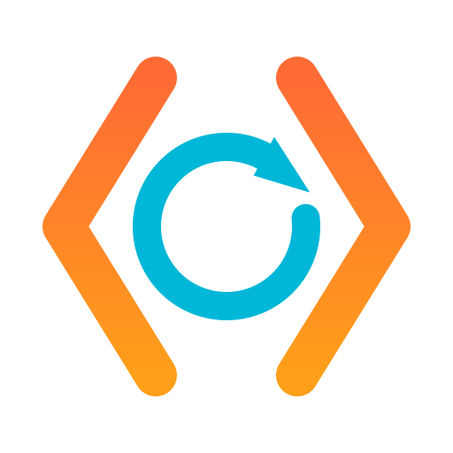

<p align="center"></p>

# ai-sdlc-loop

A public starter for building your own learning agentic loops. Take it as a base, run it on your own work, and let it learn how you and your team build software.

It is a base, not a finished product. Fork it, copy it, strip out what you do not want, and let your own experience change it.

## Status

This repo is being built in phases. Right now it has the structure, the 103 principles as data and one file each, one skill per principle with its sources, the list of 45 source repos, the coordinator and the producer and reviewer agents for each phase, the slash commands, the learning website, the developer guides, CI, and the process for keeping all of it fresh. Each folder has a short README that says what will go in it.

## How this came about

At Shravi Limited we are building aidev, a software engineering team in a box. I wanted agents that do real software work end to end without me steering every step.

The ideas for that are scattered across dozens of public repos: skills, sub-agents, slash commands, rules files. Lots of them say the same thing in different words. Some contradict each other. Some are risky to install. And if you load them all, the descriptions alone eat your context window before the agent does anything useful.

So I had a research bot, Rex, read 41 public repos covering roughly 1,060 skills, sub-agents and commands. The result was 108 principles in 9 categories, and a dedupe pass merged five duplicates, leaving 103 (see [MERGES.md](MERGES.md)). This repo turns that research into something you can use, and something that can be redone as the field moves.

## What it aims to do

1. Give you a set of principles that are written down, numbered, and traceable to where they came from.
2. Turn each principle into one skill an agent can load when it needs it, with the sources and the dedupe notes next to it.
3. Give you agents and slash commands that use those skills and can look up the principles they rely on.
4. Let you start a new project from a template with all of that wired in.
5. Learn from every project, and get better each time.

The point is not my 103 principles. The point is the loop that produced them and the loop that keeps improving them. Swap in your own.

## From prompt to context to harness

I think of this as three steps.

**Prompt engineering** is writing a good instruction. It helps, but it is one message.

**Context engineering** is deciding what the model sees: which files, which spec section, which rules, nothing more. A lot of agent failures are context failures: too much loaded, or the wrong thing loaded.

**Harness engineering** is building the system around the model: who starts which agent, with what context, who checks the work, what gets written to disk, what gets learned afterwards. The model is one part. The harness is what makes it reliable.

This repo is mostly harness. Skills are layered so a short description is always in view and the full body only loads when it is needed. That keeps things cheap and predictable.

## The coordinator model

I only talk to one agent, the coordinator. It does not do the work itself. It plans, then starts new agents with blank contexts and gives each one exactly the context it needs for its job. When they finish, it reviews what came back and decides what happens next.

Blank contexts matter. An agent that has not seen the whole conversation cannot be misled by it, and it cannot carry earlier mistakes forward.

## Independent loops

Once a loop starts, it runs on its own. It does not come back to me at every step. It comes back at the end of a cycle, with the result and a request for feedback.

Every phase in the loop is a pair:

- a **producer**, which gets the dos and don'ts for that phase in one pass, and
- an **adversarial reviewer**, which checks only against the don'ts and known failure modes, and is strictly there to find problems.

After the last phase there is a human acceptance review. That is where my judgement goes, and only there.

## The Learn loop

The end-of-cycle review feeds the Learn category (principles 9.1 to 9.12). When I give feedback, the loop asks three things in order:

1. Which phase failed, and how?
2. Which do or don't rule was at fault?
3. How do we harden that phase's checklist so it is caught next time?

A change only goes live if it helps on cases held out from the one that caused it, and a human approves it. Every accepted and rejected edit is recorded. If a mistake is mechanical, the fix is a lint or a CI check, not another paragraph in a prompt.

## What is in the repo

| Path | What it holds |
| --- | --- |
| `principles/` | One file per principle. Generated from `data/principles.json`. |
| `MERGES.md` | Log of principles merged into others, with the old ID, the new ID, the reason and the date. |
| `data/` | The source of truth: principles, source repos, changelog, the skill map, taxonomy, source mapping, licences and scorecard, and JSON schemas. |
| `skills/` | One amalgamated skill per principle (103), with a `SOURCES.md` next to each. |
| `agents/` | The coordinator, and a producer and an adversarial reviewer for each of the nine phases. Generated from the skill map and taxonomy by `scripts/build-agents.py`. |
| `commands/` | Slash commands for the main loop: plan, design, build, verify, review, ship, retro. Generated by `scripts/build-agents.py`. |
| `guides/developer/` | Plain-language guides: the Developer Guide to named principles, Principles for Building Quality Software and Apps, using the agents and commands, and testing the skills. Published on the site by `scripts/build-site.py`. |
| `docs/` | The static website (GitHub Pages), generated from `data/`. |
| `template/` | The shared base a new project copies, and `template/profiles/` with the solo, small-team and large-org overlays. |
| `scripts/` | `build-principles.py`, `build-agents.py`, `build-site.py`, `validate-data.py`, `check-skills.py`, `check-links.py`, `skillspector-scan.py`, `refresh-sources.py`, `new-project.sh`. See [scripts/README.md](scripts/README.md). |

## Start a new project from the template

Clone it and run the script with a profile:

```bash
git clone https://github.com/mitulamin/ai-sdlc-loop
cd ai-sdlc-loop
scripts/new-project.sh ../my-new-project              # solo, the default
scripts/new-project.sh ../my-new-project small-team
scripts/new-project.sh ../my-new-project large-org
scripts/new-project.sh --help                         # usage and the list of profiles
```

The script copies the shared base from `template/`, applies the profile on top, and runs `git init`. It refuses a target folder that is not empty. Then edit the new project's `AGENTS.md` (stack, commands, conventions, boundaries), read its `PROCESS.md`, and start your first loop.

### Pick a profile

An individual and a large company share the same principles. What changes is ceremony: gates, roles, review and ownership. So there is one base template, and three profiles that switch that ceremony on or off. I did not make three separate trees.

| Profile | For | What you get on top of the base |
| --- | --- | --- |
| `solo` | One person | A short `PROCESS.md` with no gates. No roles file and no pull request template. |
| `small-team` | A few people | A light `PROCESS.md` (branch, pull request, one reviewer), a short `ROLES.md`, and the base pull request template. |
| `large-org` | Many people | `PROCESS.md` with review gates, a `ROLES.md` table with owners, `.github/CODEOWNERS`, and a pull request template with the gates as a checklist. |

Every profile starts from the same base: `README.md`, `AGENTS.md`, `CHANGELOG.md` and the MIT `LICENSE`. If you are unsure, start with `solo` or `small-team`. It is easier to add ceremony later than to remove it. The large-org profile is a starter, not a process manual.

Profiles live in `template/profiles/<name>/`. Each one is small: a `profile.txt`, an optional `omit` list of base files to leave out, and an `overlay/` folder of files to add or replace. The base is never copied into a profile. To add your own, see [CONTRIBUTING.md](CONTRIBUTING.md#add-or-change-a-template-profile).

You can also use this repo as a GitHub template (**Use this template** on the repo page), but then you get the whole repo, not a profile. The script is the intended route.

## How the repo stays alive

This is not a one-off. The research should be re-run about every six months, because the sources move, new ones appear and some disappear.

Every source repo is pinned to a commit in `data/sources.json`. `scripts/refresh-sources.py` compares each pin with the upstream head and tells you what changed. Principles and skills carry their provenance, data files have versioned schemas, and generated files are kept apart from hand-written ones so a refresh does not overwrite human edits. Every merge, drop and change is logged in `CHANGELOG.md` and `data/changelog.json`.

The full process is in [UPDATING.md](UPDATING.md).

## Make it yours

If you use this for yourself or your organisation, the intended path is: copy it, replace the principles and sources with the ones you trust, run your own projects through the loop, and let your own Learn loop reshape it. If you find something that would help everyone, send it back. See [CONTRIBUTING.md](CONTRIBUTING.md).

## Why GPLv3, and CC BY-SA for the writing

I am not a lawyer, and this is not legal advice. If you think this is the wrong licence for the intent, open an issue. I am open to discussing a better one.

I want the widest use, without restricting anyone. People should be able to include this in their own projects, and companies should be able to use it for private software development. I do not want someone to take this, add proprietary work on top, and lock that work into their own systems. If you benefit from open source, contribute back.

This is a tool for builders, not a consumer end product. I want it kept open rather than closed down into an end product.

MIT would have been my first choice. There is a clear push and pull between open and proprietary software today, and individuals' generosity is being used for financial gain. I want to back open source, so I chose GPLv3 for the code. The licence text is in [LICENSE](LICENSE).

GPL-3.0 covers `scripts/`, `data/schemas/`, and the tooling.

In short: private internal use and modification by a company is allowed, with no duty to publish, because the duties start when you distribute. Anyone who distributes a work that includes this code must release the whole combined work under GPLv3, with source. Hosted or SaaS use that never distributes the code does not start those duties. AGPL-3.0 is the licence that closes that gap. I could discuss it. I am not choosing it here.

Everything under `template/` is MIT, code and writing. The text is in [template/LICENSE](template/LICENSE). The template is meant to be copied into a new project, and GPL would stop someone who wants to start an MIT project from using it. `scripts/new-project.sh` copies the base and the profile you pick, including that licence, so the new project starts under MIT.

The writing is CC BY-SA 4.0. The full text is in [LICENSE-CONTENT](LICENSE-CONTENT). You can share and adapt it with attribution. Share-alike means derived text stays under CC BY-SA 4.0, so it stays open.

CC BY-SA 4.0 covers `README.md`, `UPDATING.md`, `CONTRIBUTING.md`, `CHANGELOG.md`, `NOTICE.md`, `ATTRIBUTIONS.md`, the principle statements and notes in `principles/`, `docs/` and `guides/`, the other markdown in this repo outside `template/`, and the data files `data/principles.json`, `data/sources.json`, `data/changelog.json` and `data/notes/`.

Those data files sit with the writing because they hold the research. The principle statements in `data/principles.json` are text. `data/sources.json` and `data/changelog.json` are the record around them. The schemas in `data/schemas/` stay GPL-3.0 with the tooling. Each file is under one licence.

Borrowed source repos keep their own licences. They are not relicensed here. Attribution is in [NOTICE.md](NOTICE.md), and every project I used or referenced is linked in [ATTRIBUTIONS.md](ATTRIBUTIONS.md).

## Sources

I never install the big curation lists wholesale. They overload context and contain files I would not trust. Anything borrowed gets scanned before it goes in.
